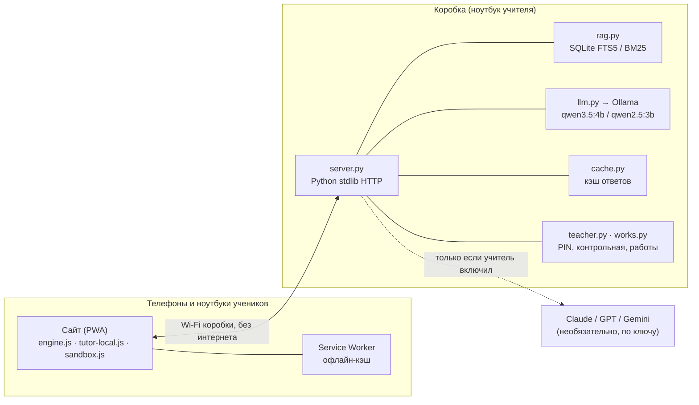

# «Знание в коробке» — документация проекта

> Все цифры в этом документе взяты из кода репозитория (ноябрь 2026). Как их пересчитать — в разделе [«Проверка цифр»](#10-проверка-цифр).

**Сайт:** https://iskander-code.github.io/znanie-box/ · **Код:** этот репозиторий · **Краткая инструкция:** [README.md](README.md) · **Питч:** [PITCH.md](PITCH.md)

---

## 1. Паспорт проекта

| | |
| --- | --- |
| **Название** | «Знание в коробке» (znanie-box) |
| **Миссия** | Дать сельской школе без интернета современную цифровую среду: библиотеку, ИИ-наставника, который учит думать, а не списывать, и тренажёр причинно-следственного мышления |
| **Целевая аудитория** | Ученики 5–11 классов сельских школ Казахстана; учителя-предметники; директора школ и муниципалитеты (как заказчики оснащения) |
| **Что это физически** | «Коробка» — обычный ноутбук или мини-компьютер в классе. Он раздаёт сеть, телефоны учеников открывают сайт по QR-коду. Интернет для работы не нужен |
| **Стадия** | Рабочий MVP: живой ИИ на локальной модели, полностью автономный веб-интерфейс, публичное демо на GitHub Pages, 56 автотестов |
| **Лицензии** | Код — MIT. Симуляции PhET — CC BY 4.0 (University of Colorado Boulder), файлы не изменены |

### Контент в цифрах

| Что | Сколько | Где в коде |
| --- | --- | --- |
| Предметы библиотеки | 7: история Казахстана, физика, алгебра, геометрия, биология, химия, география | `web/data/library/index.json` |
| Темы | 700 (по 100 на предмет), 5–11 классы | `web/data/library/*.json` |
| Интерактивные лаборатории | 36: 34 симуляции PhET на русском + 2 собственные («Закон Ома», «Парниковый эффект») | `web/phet/`, `web/sims/`, `web/data/phet.json` |
| Эталонные схемы «Что будет, если…» | 5: освоение целины, трагедия Аральского моря, закон Ома, линейная функция, окружность и круг | `web/data/graphs/` |
| Автотесты | 56: 24 (JavaScript, `node --test`) + 32 (Python, `unittest`) | `tests/` |

---

## 2. Архитектура системы

### 2.1. Двухуровневая ИИ-архитектура

**Уровень 1 — подготовка знаний (учитель + ИИ, один раз).** Учитель вставляет параграф, нейросеть предлагает схему причин и следствий в строгом JSON. Код проверяет каждую связь по цитате из текста. Связи с неточной цитатой не удаляются, а помечаются «⚠ Требует проверки учителем». Учитель исправляет и нажимает «Одобрить схему ✓». Только одобренные схемы видят ученики.

**Уровень 2 — работа в классе (без интернета).** Ученик работает с готовыми, проверенными данными:
- **последствия в симуляции** считает детерминированный алгоритм (`engine.js`), а не нейросеть. Результат мгновенный, одинаковый при каждом запуске и проверяемый;
- **нейросеть** нужна только там, где нужен язык: подсказки Совы, разбор прогноза, советы по карте мыслей. Модель работает на самой коробке через Ollama;
- **если модели нет**, всё работает на встроенных правилах в браузере.



Если Коробки рядом нет (демо на GitHub Pages), сайт работает в **демо-режиме**: поиск, схемы, подсказки Совы, лаборатории и песочница выполняются прямо в браузере. Нейросеть на компьютере (Ollama) подключается по кнопке.

### 2.2. Бэкенд (`server/`)

Только стандартная библиотека Python 3.10+, без pip. Коробку можно поставить с флешки на компьютер без интернета.

| Модуль | Что делает |
| --- | --- |
| `server.py` | HTTP-сервер (`ThreadingHTTPServer`): раздаёт сайт со сжатием gzip, обслуживает 27 API-адресов (`/api/...`), выдаёт ответы потоком (NDJSON), режим `--box` для раздачи классу |
| `rag.py` | Поиск по библиотеке: SQLite FTS5 с ранжированием BM25 по основам слов; порог «тема есть в библиотеке / нет» |
| `llm.py` | Клиент Ollama: выбор модели (`qwen3.5:4b` → `qwen3:4b` → `qwen2.5:3b` → `gemma3:4b` → `gemma3:1b`), прогрев при запуске, без видеокарты — `qwen2.5:3b`, модель держится в памяти 60 минут, предел длины ответа, потоковый вывод; выбор нейросети для ответов и переход на локальную, если онлайн-сервис недоступен |
| `online.py` | Необязательные онлайн-нейросети по ключу: Claude (`claude-opus-5-5`), GPT (`gpt-5-mini`), Gemini (`gemini-4-hydrogen`). Запросы — HTTPS из стандартной библиотеки, ответ потоком (SSE). Ключ хранится только на коробке (`data/keys.json` или переменная окружения), на страницу уходят лишь последние 4 символа |
| `graphs.py` | Построение схемы из параграфа (Ollama — по JSON-схеме, онлайн-модели — JSON в ответе), нечёткая проверка цитат (буквы и цифры, похожесть фрагмента ≥ 65%, совпадение основ слов), флаг `verified`; разбор идеи ученика и «своего условия» |
| `teacher.py` | Вход учителя по PIN (хэш PBKDF2-SHA256, 5 попыток — блокировка на минуту), смена PIN, режим контрольной, обезличенная статистика тем и ошибок в симуляциях |
| `works.py` | Работы учеников из «Песочницы» — SQLite (`data/works.sqlite`): сдача, список, отзыв и оценка учителя |
| `cache.py` | Кэш ответов на частые вопросы — SQLite (`data/cache.sqlite`): одинаковый вопрос класса отдаётся мгновенно |
| `tts.py` | Озвучка через Piper TTS, если он установлен (иначе озвучивает браузер) |

**Безопасность и надёжность:** функции учителя — только по токену после PIN; режим контрольной проверяется на сервере (из браузера его не обойти); ключи онлайн-нейросетей не попадают в браузеры учеников; размер запросов ограничен; при обрыве интернета сервер отвечает локальной моделью, а без неё — сайт переходит на встроенный разбор.

### 2.3. Фронтенд (`web/`)

Чистый JavaScript (ES-модули), без сборки, без CDN, без внешних шрифтов — всё работает офлайн.

| Модуль | Что делает |
| --- | --- |
| `app.js` | Страницы и маршруты, Сова, кабинет учителя, библиотека, лаборатории |
| `engine.js` | Движок симуляции: изменение распространяется по графу волнами (вклад = изменение × знак × сила/3 × 0,85), петли обратной связи затухают сами; поиск петель, проверка прогнозов |
| `graph-view.js` | Своя SVG-раскладка графа слоями; масштаб, перетаскивание пальцем и мышью, полноэкранный режим; смысловые подписи связей вместо «+ / −» |
| `tutor-local.js` | Сова без нейросети: BM25-поиск, сократические подсказки, викторина, проверка прогноза словами |
| `simulation-ui.js` | Прогноз словами, цепочка домино, «Разбор результатов с Совой», общий запрос к ИИ (поток + кэш + встроенный разбор) |
| `sandbox.js` | «Песочница»: карта мыслей, заметки, «+ В карту мыслей» из чата, отправка работы, вкладка «Работы учеников» |
| `ideas.js` | «Своё условие» текстом, идеи ученика на схеме, встроенный разбор идеи |
| `doc-structure.js` | Главное, термины, формулы и вопросы «Проверь себя» для каждой темы |
| `llm-browser.js`, `online-browser.js` | Нейросеть без коробки: Ollama на этом компьютере (по кнопке) или онлайн-нейросеть по ключу (ключ — только в `sessionStorage` вкладки) |
| `markdown.js` | Безопасный рендер Markdown ответов ИИ (HTML модели не выполняется) |
| `a11y.js` | Три темы: светлая, тёмная, режим для особых потребностей; озвучка текста |
| `qr.js` | Генератор QR-кода без библиотек (сверен с эталонной библиотекой: 80 из 80 кодов совпали) |
| `teacher.js` | Вход учителя и статистика на сайте без коробки |
| `sw.js` | Service Worker: сайт сохраняется на устройстве; файлы проверяются по сети (свежая версия), без сети — копия; опыты PhET (95 МБ) **не** загружаются заранее — каждый сохраняется при первом открытии |

**Доступность.** Вёрстка от 320 до 1920 px без горизонтальной прокрутки, кнопки не меньше 44×44 px. Режим для особых потребностей: шрифт +20%, межстрочный интервал 1,7, палитра Okabe-Ito (синий #0072B2 и оранжевый #D55E00 вместо красного и зелёного, смысл дублируется значками ▲▼), без анимаций, озвучка. Цвета подобраны под WCAG AAA; инструментальная проверка контраста — в плане работ.

### 2.4. Данные

```
web/data/library/   7 предметов × 100 тем (id, класс, раздел, название, текст)
web/data/graphs/    5 эталонных схем: узлы, связи (знак, сила, задержка, цитата, смысловой глагол), сценарии, вопросы
web/data/phet.json  36 лабораторий: темы библиотеки, задание «Попробуй»
data/               на коробке: state.json (PIN-хэш, контрольная, статистика), cache.sqlite, works.sqlite, keys.json — не попадают в git
```

---

### 2.5. Генеративный ИИ, применённый при разработке

- **Claude Code** (модель **Claude Opus 5.5**, Anthropic) — основной инструмент разработки. С его помощью написаны и переработаны код сервера и сайта, 56 автотестов, тексты 700 тем библиотеки, задания к лабораториям, собственные симуляторы и эта документация. Команда ставила задачи, принимала решения и проверяла каждое изменение автотестами и вручную в браузере.
- Тексты библиотеки подготовлены с помощью ИИ и написаны для проекта; перед использованием на уроках их проверяет учитель-предметник.
- В самом продукте генеративный ИИ — это локальная модель Qwen через Ollama и (по желанию учителя) Claude, GPT или Gemini; см. раздел 2.2.

## 3. Руководство пользователя

### 3.1. Ученик

1. **Сова** (вкладка «Сова»). Задай вопрос по теме. Сначала Сова задаёт наводящий вопрос и цитирует учебник (метод Сократа), по кнопкам — «Ещё подсказка» и «Покажи ответ». Источник подписан: предмет, класс, раздел. Под ответом — «🔊» (озвучить) и «+ В карту мыслей».
2. **Что будет, если…** Выбери схему, измени условие (готовое, ползунком или своим текстом: «Что, если построили плотину выше по течению?»). Отметь прогноз на узлах и/или напиши его словами, нажми «Запустить и проверить прогноз». Изменение пройдёт по схеме волнами. Под схемой — «Цепочка домино» (сразу → через годы → долгосрочно) и «Разбор результатов с Совой»: она сравнит прогноз с результатом и ответит на вопросы. Схему можно развернуть на весь экран.
3. **Моя идея.** Придумай свой фактор или решение (например, «Капельное орошение»), соедини стрелкой со схемой, напиши гипотезу и нажми «Проверить мою идею с Совой».
4. **Собери сам.** Разбери параграф по фразам: что причина, что следствие, «больше или меньше». Из ответов складывается схема.
5. **Песочница.** Своя карта мыслей: любые факторы, стрелки с подписями («провоцирует», «тормозит»), заметки. «Посоветоваться с Совой» — подсказки и вопросы. «Отправить работу учителю» — имя или ник и тема.
6. **Библиотека и лаборатории.** 700 тем с блоками «Главное», «Термины», «Формулы», «Проверь себя»; 36 лабораторий с заданием «Попробуй».

### 3.2. Учитель

1. Вкладка «Учителю» → PIN (по умолчанию **2026**, сменить — «Настройки Коробки»).
2. **Конструктор схем:** вставьте параграф → «Построить схему» → проверьте связи с ⚠ (подтвердите, смените знак, удалите) → «Одобрить схему ✓».
3. **Работы учеников:** откройте работу, посмотрите карту и заметки, нажмите «Спросить мнение ИИ о работе», оставьте комментарий и оценку.
4. **ИИ-помощник:** план урока, задачи с ответами, объяснение темы — заготовки подставляются в поле.
5. **Аналитика класса:** обезличенно — какие темы чаще спрашивают, где ошибаются в прогнозах.
6. **Настройки Коробки:** режим контрольной работы (на всех устройствах исчезают готовые ответы), выбор нейросети и ключи онлайн-нейросетей, смена PIN, очистка кэша.

### 3.3. Администратор / неподготовленный пользователь

Подробная инструкция с картинками и QR-кодом — на странице сайта «Как подключить» и в [README.md](README.md#как-подключить-коробку--4-шага).

1. Скопируйте папку проекта на ноутбук (нужен Python 3.10+). Для нейросети — бесплатная программа Ollama и модель (`ollama pull qwen2.5:3b`).
2. Включите на ноутбуке раздачу сети: Параметры → Сеть → «Мобильный хот-спот».
3. Дважды нажмите **«Запустить для класса.bat»**. Откроется страница с QR-кодом.
4. Ученики подключаются к раздаче и наводят камеру на QR-код. Интернет не нужен.

Проверить скорость нейросети на конкретном компьютере: `python scripts/bench.py` (на слабом — `--weak`).

---

## 4. Справочник API (коробка)

Все ответы — JSON; при `"stream": true` — поток NDJSON (`meta` → `delta`… → `done`). Адреса с пометкой 🔒 — только после входа учителя (заголовок `X-Teacher-Token`).

| Метод и адрес | Назначение |
| --- | --- |
| `GET /api/health`, `GET /api/settings` | Состояние коробки, нейросети, режима контрольной |
| `POST /api/chat` | Сова. Режимы: `socratic`, `explain`, `simpler`, `debrief`, `predict_check` (прогноз словами), `debrief_chat` (вопрос о результате), `sandbox_help` (совет по карте мыслей) |
| `POST /api/search` | Поиск по библиотеке |
| `POST /api/scenario`, `POST /api/idea` | «Своё условие» → изменения узлов; разбор идеи ученика |
| `POST /api/report`, `POST /api/report-sim` | Обезличенная статистика: «Тут ошибка», ошибки в прогнозах |
| `POST /api/student-works` | Ученик сдаёт карту мыслей и заметки |
| `GET /api/sims` | Лаборатории, которые учитель положил в `web/sims/` |
| `POST /api/tts` | Озвучка через Piper (если установлен) |
| `POST /api/teacher/login`, `/logout` | Вход и выход учителя |
| 🔒 `POST /api/settings` | Режим контрольной, выбор нейросети |
| 🔒 `POST /api/extract`, `POST /api/graphs` | Построить схему из текста; опубликовать одобренную |
| 🔒 `GET /api/teacher/summary` | Сложные темы и ошибки в симуляциях |
| 🔒 `GET /api/teacher/works`, `GET /api/teacher/works/<id>` | Работы учеников |
| 🔒 `POST /api/teacher/works/<id>/review \| ai \| delete` | Отзыв и оценка; мнение ИИ (поток); удаление |
| 🔒 `POST /api/teacher/ask` | ИИ-помощник учителя |
| 🔒 `POST /api/teacher/keys`, `/test-key`, `/pin`, `/clear-cache`, `/reset-stats` | Ключи онлайн-нейросетей, смена PIN, кэш, статистика |

---

## 5. Скорость и требования к железу

Замеры на ноутбуке с видеокартой RTX 5050 (`scripts/bench.py`).

| Режим | Модель | Первое слово | Весь ответ |
| --- | --- | --- | --- |
| Видеокарта | qwen3.5:4b | 0,2–0,9 с (ответ печатается по мере готовности) | 2,5–5 с |
| Только процессор, 4 потока | qwen2.5:3b | 3,2 с | 6,2 с |
| Только процессор, 4 потока | qwen3.5:4b | 5,6 с | 11,4 с |
| Только процессор, 2 потока | qwen2.5:3b | 5,6 с | 8,8 с |

- Сайт загружается за 169 КБ вместо 594 КБ благодаря gzip: важно, когда 30 телефонов делят одну раздачу.
- Поиск по 700 темам — 2–3 мс.
- Повторный одинаковый вопрос отдаётся из кэша за доли секунды.
- На Raspberry Pi и старых ноутбуках замер ещё предстоит; для них рекомендуется модель `qwen2.5:1.5b`.

---

## 6. Безопасность и приватность

- Вопросы учеников не покидают коробку. Аккаунтов нет. Статистика для учителя обезличена: без имён и текстов вопросов.
- Онлайн-режим (Claude, GPT, Gemini) включает только учитель; рядом с выбором предупреждение, что вопросы уходят в сервис компании.
- PIN хранится хэшем (PBKDF2-SHA256, 120 000 итераций), есть блокировка после 5 неверных попыток.
- Симуляции PhET открываются без статистики разработчиков (`yotta=false`) и без внешних ссылок (`allowLinks=false`).
- Ответы ИИ отображаются как безопасный Markdown: HTML из ответа модели не выполняется.
- Отказ онлайн-модели по правилам безопасности не обходится локальной моделью.

## 7. Тестирование

```bash
node --test tests/engine.test.mjs        # 24 теста: движок, поиск, QR, Markdown, офлайн-кэш, идеи, прогноз словами, песочница
python -m unittest discover tests        # 32 теста: поиск, проверка цитат, PIN, контрольная, кэш, онлайн-провайдеры (имитация), работы учеников
```

Тесты запускаются автоматически на GitHub при каждой публикации; сайт обновляется, только если они прошли.

## 8. Известные ограничения

- Маленькие локальные модели (3–4 млрд параметров) иногда ошибаются в фактах и логике; поэтому последствия считает алгоритм, а ответы опираются на библиотеку и цитаты. С онлайн-нейросетью качество выше.
- Тексты библиотеки написаны для проекта; номеров страниц бумажных учебников нет. Перед уроками их стоит проверить учителю-предметнику.
- Контраст WCAG AAA заложен в палитре, но инструментально не измерен.
- На сайте без коробки PIN проверяется в браузере (защита условная); настоящая защита — на коробке.
- Онлайн-нейросети с реальными ключами проверены выборочно (Gemini), остальное — тестами с имитацией сервисов.

## 9. Дорожная карта

1. Пилот в 2–3 сельских школах: замеры на реальном железе, обратная связь учителей.
2. Учебники по программе Казахстана: импорт параграфов и автоматическое построение схем с проверкой учителем.
3. Казахский язык интерфейса и библиотеки.
4. Образ коробки для Raspberry Pi 5 / мини-ПК «включил и работает».
5. Синхронизация работ и статистики между школой и районом, когда появляется интернет.

## 10. Проверка цифр

```bash
node -e "const f=require('fs');const i=JSON.parse(f.readFileSync('web/data/library/index.json'));let t=0;for(const s of i){const n=JSON.parse(f.readFileSync('web/data/library/'+s.id+'.json')).length;t+=n;console.log(s.name,n)}console.log('всего',t)"
ls web/phet/*.html | wc -l                 # 34
ls web/sims/*.html | wc -l                 # 2
grep -c "^test(" tests/engine.test.mjs     # 24
grep -c "    def test_" tests/test_server.py  # 32
```
